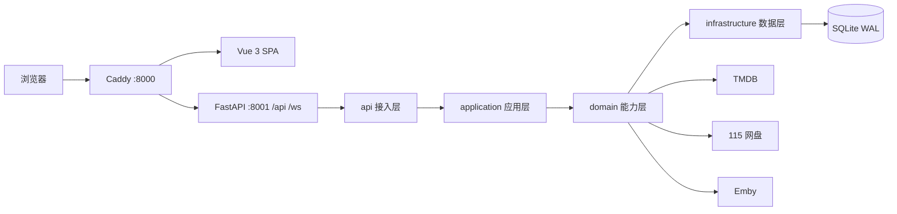

# MHTI

<p align="center">
  <a href="https://github.com/xiyan520/MHTI/actions/workflows/ci.yml"></a>
  
  
  
  
  <a href="LICENSE"></a>
</p>

<p align="center">自动解析视频文件名，从 TMDB 拉取元数据，按媒体服务器规范整理你的影视库。</p>

MHTI 是一个自托管的媒体刮削与整理工具：扫描本地目录或 115 网盘，解析文件名中的剧名、季、集，匹配 TMDB 元数据，生成 Emby / Jellyfin 兼容的 NFO，并按可配置的命名模板把视频、海报、字幕整理到目标目录。整套流程有队列、实时进度与逐文件的记录，失败可重试、可回看每一步日志。

---

## 目录

- [功能特性](#功能特性)
- [界面与路由](#界面与路由)
- [系统架构](#系统架构)
- [技术栈](#技术栈)
- [快速开始](#快速开始)
- [配置](#配置)
- [API](#api)
- [项目结构](#项目结构)
- [开发与测试](#开发与测试)
- [文档](#文档)
- [常见问题](#常见问题)
- [贡献](#贡献)
- [许可证](#许可证)

## 功能特性

| 模块 | 说明 |
| --- | --- |
| 文件名解析 | 插件式解析器（清洗 → 标准 → 日语 → 中文 → 剧名兜底），支持日期前缀、方括号结构、裸数字与全角井号集数、OVA / 特别篇标记，自动修正季号 |
| TMDB 集成 | 搜索匹配、季集存在性核验、手动填 TMDB ID；认证检测覆盖 Token 有效性与 R18 可见性 |
| 冲突处理 | 匹配不到、匹配到多季、文件冲突、Emby 冲突统一收敛到「待处理」，在记录页逐级选择剧集 / 季 / 集后重跑 |
| NFO 生成 | 生成 Emby / Jellyfin 兼容的剧集、季、单集 NFO |
| 文件整理 | 复制 / 移动 / 硬链接 / 软链接四种模式，命名模板与大小、扩展名、关键字过滤均可配置 |
| 115 网盘 | 扫码登录，展示账号身份、会员、容量与登录设备；支持 115→115 在线整理与 115→本地下载整理 |
| 图片与字幕 | 自动下载海报、背景图、剧照与单集缩略图；识别同名字幕并批量关联、重命名 |
| 目录监控 | 实时 / 兼容（全量轮询）/ 事件（115 生活事件增量）三种模式，支持本地与 115 目录 |
| 任务与记录 | 手动任务、刮削任务、定时任务三类队列；手动任务的进度按子任务真实结果统计，整批处理完才收尾 |
| 记录级操作 | 重刮、重新整理、删除产物文件、撤销，列表支持多选批量重试 |
| 安全认证 | JWT + 刷新令牌轮换，多会话管理、登录历史与失败次数限制 |
| 日志管理 | 分级落库，支持级别 / 模块 / 关键词 / 时间筛选，指标条、保留策略与导出 |

## 界面与路由

| 路径 | 页面 | 说明 |
| --- | --- | --- |
| `/` | 首页 | 统计概览、最近任务、TMDB 配置引导 |
| `/scan` | 手动任务 | 向导式创建刮削任务，任务进度与结果 |
| `/history` | 刮削记录 | 列表、筛选、多选批量重试、导出 |
| `/history/:id` | 记录详情 | 元数据、刮削日志时间轴、超时定位、记录级操作 |
| `/files` | 文件管理 | 目录浏览（本地 / 115）并发起整理任务 |
| `/settings` | 设置 | 左侧分组导航 + 右侧面板（整理 / 监控 / 下载 / 命名 / NFO / 代理 / 115 / Emby / 系统 / 日志） |
| `/security` | 安全设置 | 账户、密码、会话与登录历史 |
| `/login` | 登录 | 全页路由，不套应用壳 |

导航、命令面板（`Ctrl/⌘ + K`）与移动端底部 TabBar 均由路由 meta 派生，界面语言为中文。

## 系统架构



| 层 | 目录 | 职责 |
| --- | --- | --- |
| 接入 | `server/api` | 路由、鉴权依赖、中间件、协议转换 |
| 应用 | `server/application` | 用例编排、任务队列、历史记录、目录监控 |
| 能力 | `server/domain` | 文件名解析、TMDB、NFO / 图片 / 字幕 / 搬运、115 与 Emby 集成、身份与配置 |
| 数据 | `server/infrastructure` | 仓储、连接池、依赖注入容器、WebSocket 通道、加密 |

分层方向由 `server/tests/test_architecture.py` 用 AST 扫描全仓 import 强制，违规即测试失败。刮削主链路、状态机、前端六域约定与安全基线等细节见 [ARCHITECTURE.md](ARCHITECTURE.md)。

## 技术栈

| 后端 | 版本 | 前端 | 版本 | 部署 |
| --- | --- | --- | --- | --- |
| Python | 3.11+（镜像 3.12） | Vue | 3.5 | Docker 多阶段构建 |
| FastAPI / Uvicorn | 0.109+ / 0.27+ | TypeScript | 5.9 | Caddy（反代 + 静态文件） |
| Pydantic | 2.6+ | Vite | 7.2 | SQLite（WAL） |
| aiosqlite | 0.19+ | Pinia / Vue Router | 3.0 / 4.6 | GitHub Actions |
| httpx[socks] | 0.27+ | Naive UI | 2.43 | — |
| p115client | 0.0.9.6.5.1 | Axios | 1.13 | — |

其余后端依赖：`watchdog`（目录监控）、`croniter`（定时表达式）、`sse-starlette`（日志流）、`python-jose`（JWT）、`cryptography`（敏感配置加密）。

## 快速开始

### 环境要求

- Docker 部署：Docker 24+ 与 Docker Compose v2，无需本机安装 Python / Node。
- 源码运行：Python 3.11+、Node 20.19+（构建前端，镜像内使用 Node 24）。
- 可访问 `api.themoviedb.org` 的网络，或一个 HTTP 代理。

### Docker 部署（推荐）

```bash
git clone https://github.com/xiyan520/MHTI.git
cd MHTI

docker compose up -d
docker compose logs -f
```

打开 <http://localhost:8000>，按首页引导填入 TMDB Token 即可开始。API 文档位于 <http://localhost:8000/api/docs>。

`docker-compose.yml` 的最小配置：

```yaml
services:
  mhti:
    image: xiyan520/mhti:latest
    container_name: mhti
    restart: unless-stopped
    ports:
      - "8000:8000"                  # 唯一对外入口（Caddy）
    volumes:
      - ./data:/app/data             # 数据库、密钥、日志
      - ./Caddyfile:/etc/caddy/Caddyfile:ro
      # - /path/to/media:/media:ro   # 媒体库（按需挂载）
      # - /path/to/output:/output    # 输出目录（按需挂载）
    environment:
      - DATA_DIR=/app/data
      - TZ=Asia/Shanghai
```

容器内 Caddy 监听 `8000`，uvicorn 只监听 `127.0.0.1:8001`，前端静态文件由 Caddy 直接提供。

### 源码运行

```bash
# 后端（工作目录：项目根）
python -m venv .venv
source .venv/bin/activate            # Windows: .\.venv\Scripts\activate
python -m pip install -r requirements.txt
python -m uvicorn server.main:app --host 127.0.0.1 --port 8000

# 前端（工作目录：web/）
npm install
npm run dev                          # http://127.0.0.1:3000，/api 与 /ws 代理到 8000
```

本机直连 TMDB 不通时需要带代理启动后端，否则刮削统一返回 502：

```bash
HTTP_PROXY=http://127.0.0.1:10808 \
HTTPS_PROXY=http://127.0.0.1:10808 \
ALL_PROXY=http://127.0.0.1:10808 \
python -m uvicorn server.main:app --host 127.0.0.1 --port 8000
```

### 首次使用

1. 注册管理员账户并登录。
2. 在设置页填入 TMDB API Token，点击验证（同时检测 R18 可见性）。
3. 选择扫描目录与目标目录（本地或 115），在「手动任务」里创建第一批任务。
4. 在「刮削记录」查看逐文件结果；停在「待处理」的记录需要你确认季集或冲突处理方式。

## 配置

### 环境变量

| 变量 | 默认值 | 说明 |
| --- | --- | --- |
| `DATA_DIR` | `/app/data` | 数据目录：SQLite、加密密钥、日志、115 客户端缓存均由它派生 |
| `TZ` | `Asia/Shanghai` | 容器时区 |
| `APP_VERSION` | 代码内置版本 | 覆盖前端展示的版本号 |

其余配置都在设置页维护并落库：TMDB Token、代理、整理与命名规则、下载范围、NFO 字段、监控模式、Emby 连接、任务并发与超时、日志级别与保留策略。

### 整理模式

| 模式 | 值 | 说明 | 适用场景 |
| --- | --- | --- | --- |
| 复制 | `copy` | 复制文件 | 保留原始文件 |
| 移动 | `move` | 移动文件 | 节省空间 |
| 硬链接 | `hardlink` | 创建硬链接 | 同分区去重（仅本地） |
| 软链接 | `symlink` | 创建软链接 | 跨分区引用（仅本地） |

搬运使用「同目录临时文件 + `os.replace`」原子落盘，跨盘先复制后删源；失败或取消不会留下半成品。

### 115 网盘

| 能力 | 说明 |
| --- | --- |
| 扫码登录 | 设置页生成二维码，登录凭证加密入库 |
| 账号信息 | 身份、会员等级与到期时间、容量占用、登录设备 |
| 目录浏览 | 选择源 / 目标目录，含目录缓存与悬停预取 |
| 115→115 整理 | 视频在云端复制 / 移动并改名，NFO 与图片保留本地 |
| 115→本地整理 | 从云端下载视频后按本地流程整理 |
| 限流提示 | `fs_files` 请求过密会返回 405，界面提示稍后重试 |

## API

所有接口以 `/api` 为前缀，交互式文档见 `/api/docs`（OpenAPI）。除注册、登录与健康检查外均需 Bearer 令牌，访问令牌 15 分钟过期，用刷新令牌轮换。

| 分组 | 前缀 | 主要能力 |
| --- | --- | --- |
| 认证 | `/api/auth` | 注册、登录、刷新、登出、状态与令牌校验、账户信息与头像、会话管理、登录历史 |
| 配置 | `/api/config` | 代理、语言、TMDB Token（保存 / 状态 / 验证）、整理、下载、命名、NFO、监控、系统参数、115 登录与账号 |
| 文件与解析 | `/api/files`、`/api/parser` | 目录浏览、扫描、文件名解析预览 |
| 刮削 | `/api/scraper`、`/api/tmdb` | 单文件刮削、按 TMDB ID 刮削、预演、TMDB 手动搜索 |
| 任务 | `/api/manual-jobs`、`/api/scrape-jobs`、`/api/scheduler` | 创建、列表、详情、删除、进度 |
| 记录 | `/api/history` | 列表、详情、解析冲突、重刮、重新整理、删除产物、撤销、日志 SSE 流 |
| 产物与工具 | `/api/nfo`、`/api/images`、`/api/rename`、`/api/subtitles`、`/api/templates` | NFO、图片、重命名、字幕、命名模板 |
| 监控 | `/api/watcher` | 监控目录与扫描模式 |
| 集成与运维 | `/api/emby`、`/api/logs`、`/health` | Emby 校验、日志查询与导出、健康检查 |
| 实时 | `/ws` | 任务进度与待处理通知（令牌走查询参数） |

## 项目结构

```text
MHTI/
├── server/                       # Python 后端（四层架构）
│   ├── main.py                   # FastAPI 装配与路由挂载
│   ├── bootstrap.py              # 组合根：服务注册与工厂
│   ├── common/                   # 共享内核（异常体系、HTTP 工具）
│   ├── api/                      # 接入层（deps / middleware / v1 路由）
│   ├── application/              # 应用层（刮削编排、三类队列、监控、记录）
│   ├── domain/                   # 能力层（解析、元数据、产物、集成、身份、系统）
│   ├── infrastructure/           # 数据层（仓储、连接池、实时通道、安全）
│   ├── models/                   # Pydantic 数据模型
│   └── tests/                    # 测试（含分层架构断言）
├── web/                          # Vue 3 前端
│   └── src/
│       ├── config/  shared/  layouts/  router/  stores/
│       └── modules/              # auth · home · scrape · history · library · settings
├── data/                         # 运行时数据（SQLite、密钥、日志，内容不入库）
├── Dockerfile                    # 多阶段构建：Node 构建前端 + Python 运行时 + Caddy
├── docker-compose.yml            # 容器编排
├── Caddyfile                     # 反向代理与静态文件
├── start.sh                      # 容器启动脚本（Caddy + uvicorn）
├── run_server.py                 # 本机启动脚本
├── requirements.txt              # 运行依赖（镜像与 CI 的安装真源）
├── requirements-dev.txt          # 开发依赖（pytest / ruff / mypy）
└── pyproject.toml                # 项目元数据与工具配置
```

## 开发与测试

### 后端

```bash
python -m pip install -r requirements-dev.txt

ruff check server                     # 静态检查
mypy                                  # 类型门禁（models 与 common 已纳入 strict）
pytest server/tests -q                # 单元测试
pytest --cov=server --cov-report=html # 覆盖率
```

测试使用临时数据目录隔离，不会读写 `data/scraper.db`。

### 前端

```bash
cd web
npm ci
npm run dev          # 开发服务器
npm run lint         # ESLint
npm run build:check  # vue-tsc -b && vite build，提交前必跑
npm run format:check # Prettier
```

### 质量门禁

| 命令 | 作用 | 位置 |
| --- | --- | --- |
| `ruff check server` | Python 静态检查 | CI |
| `mypy` | 渐进式类型检查 | CI |
| `pytest server/tests -q` | 后端用例（含分层依赖断言） | CI |
| `npm run lint` | 前端 ESLint | CI |
| `npm run build:check` | 前端类型检查与构建 | CI / 本地 |

CI 执行同一套命令，任一步失败都会让 PR 变红。

### 提交规范

采用 [Conventional Commits](https://www.conventionalcommits.org/zh-hans/)：

```text
<type>(<scope>): <subject>

<body>
```

常用类型：`feat` 新功能、`fix` 修复、`refactor` 重构、`perf` 性能、`test` 测试、`docs` 文档、`chore` 构建与工具、`style` 格式。正文说明「改了什么、为什么改」，不写调试过程与用例数字。

命名约定：Python `snake_case`、TypeScript `camelCase`、Vue 组件 `PascalCase`。

## 文档

| 文档 | 内容 |
| --- | --- |
| [ARCHITECTURE.md](ARCHITECTURE.md) | 分层边界、组合根、刮削主链路与状态机、前端六域约定、安全基线 |
| [CHANGELOG.md](CHANGELOG.md) | 版本变更记录（Keep a Changelog 格式） |
| [RELEASING.md](RELEASING.md) | 版本号规则、打标签与镜像发布流程 |
| [LICENSE](LICENSE) / [NOTICE](NOTICE) | Apache License 2.0 与版权声明 |

## 常见问题

**刮削一直返回 502 / 搜不到任何结果**
后端访问不到 `api.themoviedb.org`。按上文用 `HTTP_PROXY` / `HTTPS_PROXY` 启动，或在设置页配置代理后点「测试连通性」。

**提示「请先在设置中开启成人内容可见性」**
TMDB 账号未开启成人内容显示。到设置页的 TMDB 分区重新验证 Token，开启该选项后再试；未探测过的状态不会拦截。

**手动任务一直显示「运行中」**
该任务的进度按子文件真实结果统计，只有整批文件处理完才收尾。若有文件停在「待处理」（冲突未决），任务会保持运行中，在记录页处理掉即可。

**115 报 405 或频繁失败**
`fs_files` 接口有调用频率限制，稍后重试；事件监控模式对频率更敏感，可切换到兼容模式。

**数据在哪、怎么备份**
都在 `DATA_DIR`：SQLite 库、`.secret_key`（用于解密 Token / Cookie）、日志。备份该目录即可，`.secret_key` 丢失会导致已加密配置无法解密。

## 贡献

1. Fork 本仓库并从 `main` 切出特性分支：`git switch -c feat/your-feature`。
2. 改动后跑通上文「质量门禁」的全部命令。
3. 提交遵循 Conventional Commits，一个提交只做一件事。
4. 发起 Pull Request，说明动机、方案与验证方式；涉及分层或刮削主链路的改动请同步更新 [ARCHITECTURE.md](ARCHITECTURE.md)。

缺陷与建议请用 Issue 反馈，附上复现步骤与相关日志（注意隐去 Token、Cookie 与路径中的个人信息）。

## 许可证

本项目基于 [Apache License 2.0](LICENSE) 发布，版权归 xiyan520 所有。分发修改版本时请保留 [NOTICE](NOTICE) 中的声明。

## 致谢

- [TMDB](https://www.themoviedb.org/) 提供元数据 API。
- [p115client](https://github.com/ChenyangGao/p115client) 提供 115 网盘开放接口封装。
- [FastAPI](https://fastapi.tiangolo.com/)、[Vue](https://vuejs.org/)、[Naive UI](https://www.naiveui.com/) 等项目提供基础设施。

## 支持项目

如果 MHTI 对你有帮助，可以请作者喝杯咖啡：

<p align="center"></p>

